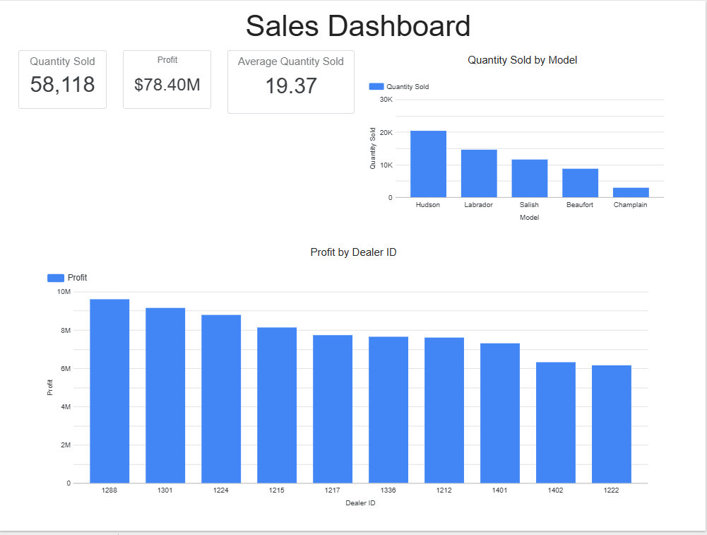
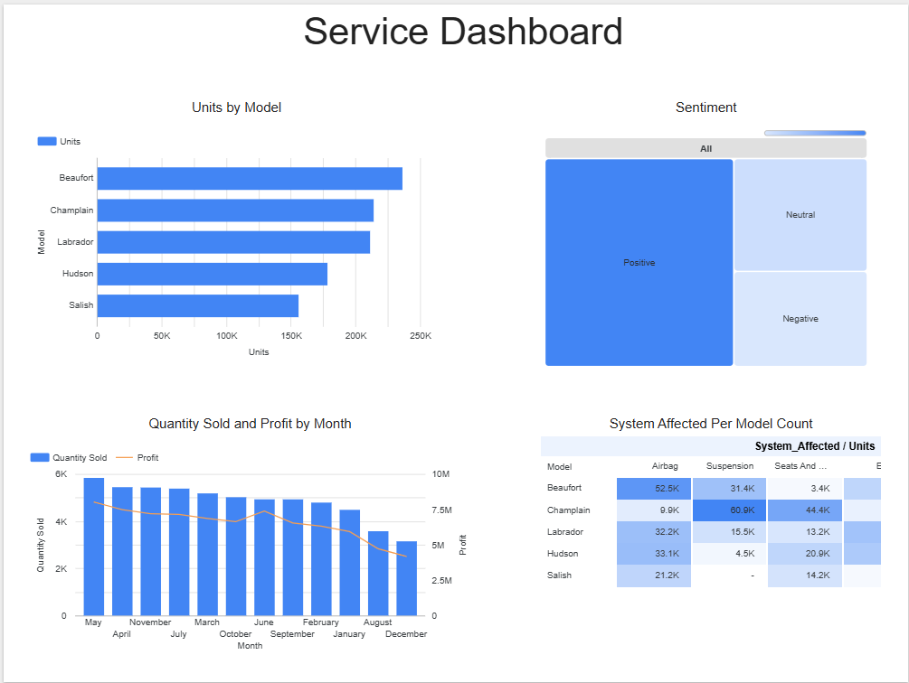

# Automobile Sales & Service Performance Dashboard

## 📌 Project Overview

This project focuses on developing an interactive Sales and Service Performance Dashboard using **Google Looker Studio**.

The objective is to help regional managers of an automobile dealership chain monitor sales performance, profitability, customer sentiment, and vehicle recalls through data visualization.

## 🛠️ Tools & Technologies

- Google Looker Studio
- Google Sheets
- Data Visualization
- Business Intelligence
- KPI Analysis

## 📊 Dataset

The dataset is based on a modified subset of the IBM Accelerator Catalog dataset, provided as part of a hands-on learning project.

## 📈 Dashboard Details

### 1. Sales Dashboard

The Sales Dashboard provides an overview of dealership sales performance through the following KPIs and visualizations:

- **Total Profit:** Displays overall profit generated.
- **Quantity Sold:** Shows the total number of vehicles sold.
- **Quantity Sold by Model:** Compares vehicle sales across different models.
- **Average Quantity Sold:** Displays the average quantity sold.
- **Profit by Dealer ID:** Compares profitability across different dealerships.

### 2. Service Dashboard

The Service Dashboard focuses on customer experience and vehicle service performance.

- **Vehicle Recalls by Model:** Analyzes the number of recalls for each car model.
- **Customer Sentiment Analysis:** Visualizes positive, neutral, and negative customer reviews using a treemap.
- **Monthly Sales vs. Profit:** Compares monthly vehicle sales and profit using a combo chart.
- **Recalls by Model and Affected System:** Uses a pivot table with heatmap formatting to identify recall patterns.

## 🖼️ Dashboard Screenshots

### Sales Dashboard

### Service Dashboard

### Combined Dashboard

## 🎯 Project Objectives

- Monitor automobile dealership sales and service performance.
- Analyze profitability across different dealers.
- Understand customer sentiment through review analysis.
- Identify vehicle recall patterns.
- Present business insights through interactive dashboards.

## 💡 Key Skills Demonstrated

- Dashboard Development
- Data Visualization
- KPI Monitoring
- Sales Performance Analysis
- Customer Sentiment Analysis
- Business Intelligence
- Data Interpretation
- Interactive Reporting

## 📁 Project Deliverables

- Two-page interactive dashboard (Sales and Service).
- Visual representation of business KPIs.
- PDF export of the completed dashboard.

## 🔗 Dashboard Access

**Google Looker Studio Report:** [https://datastudio.google.com/s/igpblT-er1E]

## 📚 Data Source & Acknowledgement

Dataset: IBM Accelerator Catalog.

**Project Type:** Data Analytics & Business Intelligence

**Visualization Tool:** Google Looker Studio
